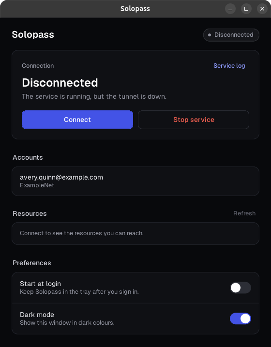

# solopass

A system tray client for Twingate on Linux. The tray icon shows whether the tunnel is up, and its menu connects and disconnects, opens the sign-in page in the browser, switches accounts, and stops the service. A resource policy that still needs a sign-in when the tunnel comes up has its sign-in started at once, so the page opens in the browser before anything tries to reach a resource behind it. The window offers the same actions and lists the resources the account can reach. A desktop with no tray host, such as GNOME without the AppIndicator extension, gets the window after ten seconds instead.



Each action runs the `twingate` command line, which has to be set up first with `sudo twingate setup`. An action that needs root goes through `pkexec`, and the polkit rule in `contrib/50-solopass.rules` lets an active local member of the `sudo` or `wheel` group connect, stop the service, and switch accounts without a password. The Service log link in the window opens the newest entries of the `twingate.service` journal, which `journalctl` shows only to a user who can read the system journal, such as a member of the `adm`, `systemd-journal`, or `wheel` group.

The installer sets up the program, Twingate, and the polkit rule in one command.

```sh
curl -fsSL https://raw.githubusercontent.com/braycarlson/solopass/main/contrib/install.sh | sh
```
